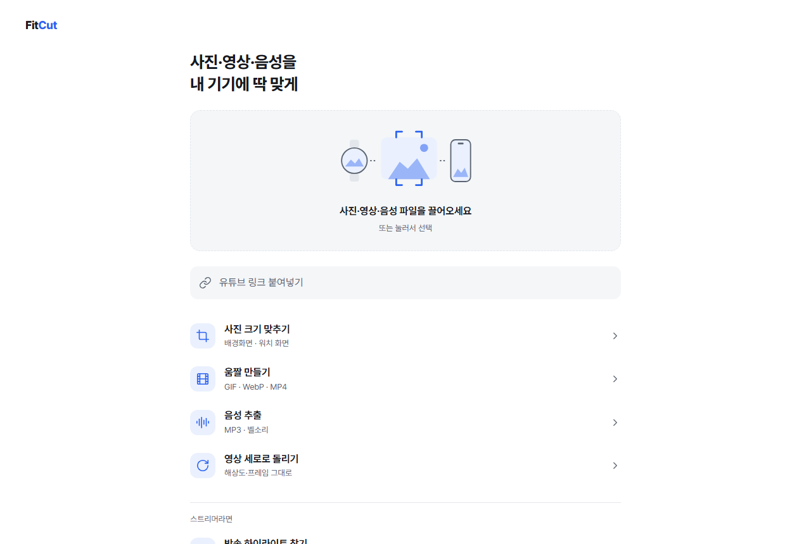
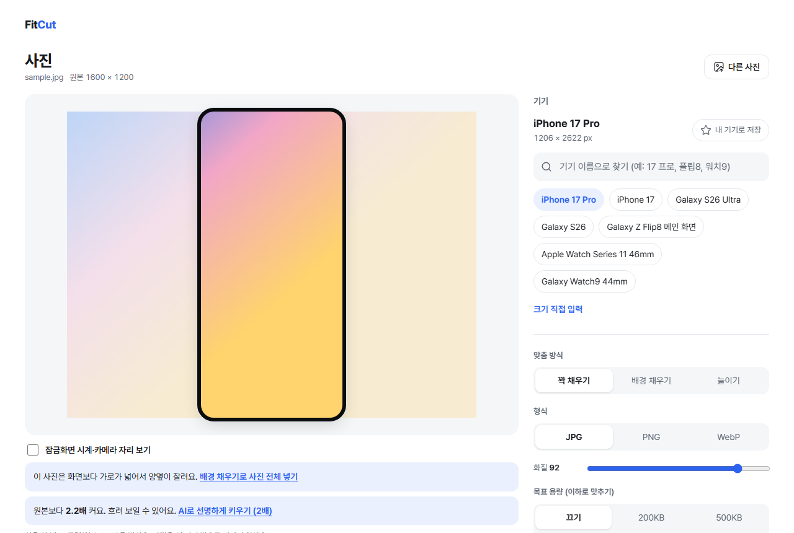
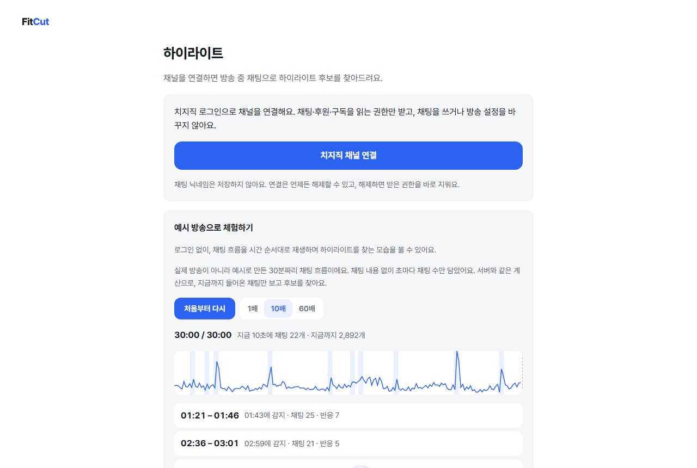
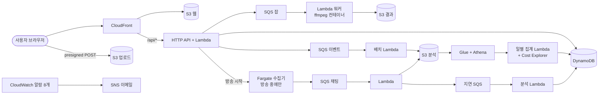

# FitCut (가칭)

사진·영상·음성을 내 기기에 딱 맞게. 폰 배경화면, 워치 페이스, 움짤, 벨소리, 방송 하이라이트를 한 곳에서 만드는 웹 서비스.

**클라우드 포트폴리오 프로젝트**다. 기능만큼 중요한 목표는 **AWS 서버리스로 쓰지 않을 때 비용이 0에 가까운 구조를 만들고, 그 근거를 숫자로 남기는 것**이다.

- 데모: https://d2iecjbez8jmja.cloudfront.net (main에 머지하면 자동 배포되는 dev 환경)
- 상태: M0~M5 기능 완료, M7 운영 고도화(관측성·비용 리포트·부하 테스트·브라우저 변환 비교) 완료. 남은 것은 실제 방송 데이터로 하는 정확도 측정 ([로드맵](docs/ROADMAP.md))

| 홈 | 사진: 기기에 맞춰 자르기 | 하이라이트: 예시 방송 리플레이 |
| --- | --- | --- |
|  |  |  |

## 숫자로 보는 결과

| 무엇을 | 결과 |
| --- | --- |
| 이번 달 AWS 사용 금액 | **$0.10** (2026-10-01~13, 크레딧 적용 전. 청구액 $0). 가장 큰 항목은 Cost Explorer API $0.05 |
| 쓰지 않을 때 비용 | 상시 켜진 서버 0개. EC2·NAT Gateway·상시 Fargate·프로비저닝된 동시성 없음 |
| 사진 작업당 서버 비용 | **$0**. 브라우저(Web Worker)에서 처리하고, 사진은 서버로 보내지 않는다 |
| GIF 잡당 비용 | 약 $0.0002 (1080×1920 60fps 5초 → 480px, Lambda arm64 2GB). 실제 잡 10건 평균 약 $0.00007 |
| 변환 처리 시간 | 실제 GIF 잡 10건 p50 1.7초 · p95 8.7초 (입력 크기 섞임, 2026-10-10~14, Athena 사용 이벤트) |
| Lambda 메모리 결정 | 1024MB는 2배 느리고 비용은 같음, 3008MB는 10% 빠르고 30~40% 비쌈 → 2048MB ([ADR-002](docs/DECISIONS.md)) |
| 부하가 몰릴 때 | API 초당 30건 → 상한 10건 넘는 요청은 429, 통과한 요청 p95 39ms. 잡 4개 동시 → 워커 2개씩 차례로, 최대 4.2초 ([ADR-048](docs/DECISIONS.md)) |
| 브라우저 변환(ffmpeg.wasm) vs 서버 | PC 브라우저 약 6초 + wasm 30.7MB 내려받기 / 서버 업로드 1.5초 + 7.5초 → 서버 유지 ([ADR-003](docs/DECISIONS.md)) |

전체 측정 기록은 [아래 표](#측정-기록)에 있다.

## 주요 기능

| 도구 | 하는 일 | 처리 위치 |
| --- | --- | --- |
| 사진 | 리사이즈·크롭, 아이폰·갤럭시·폴드·플립·아이패드·갤럭시 탭·애플워치·갤럭시 워치 프리셋, 여러 기기 한 번에(ZIP), 목표 용량 맞추기, HEIC, AI 업스케일 | 브라우저 |
| 움짤 | 프레임 단위 구간 선택, GIF·WebP·MP4, 워치 화면 크기 | Lambda (ffmpeg) |
| 음성 | 영상에서 음성 추출, 구간 자르기, 페이드, 음량 맞추기, 벨소리(M4R·MP3) | Lambda (ffmpeg) |
| 세로로 돌리기 | 다시 압축 / 회전 정보만 바꾸기 | Lambda (ffmpeg) |
| 링크 구간 | 유튜브 링크를 공식 플레이어로 재생하며 구간 저장·반복 재생 (영상은 내려받지 않는다) | 브라우저 + 작은 API |
| 하이라이트 | 스트리머가 치지직 채널을 연결하면 라이브 채팅으로 하이라이트 후보를 찾고, 녹화 파일에서 바로 클립·움짤로 | 방송 중에만 Fargate, 분석은 Lambda |
| 관리자 | 사용 분석, 비용, 보관 동의 파일, 감사 로그 (Cognito + MFA) | Lambda + Athena |

## 아키텍처



- **가장 싼 곳에서 처리한다.** 브라우저 > Lambda > Fargate 순서. 사진은 브라우저에서 끝내고, 영상은 측정해 보니 입력 제한 안의 작업이 모두 Lambda 시간 안에 끝나서 Fargate로 보낼 작업이 없었다 ([ADR-002](docs/DECISIONS.md)).
- **상시 과금 리소스를 만들지 않는다.** 채팅 수집기는 방송 중에만 도는 Fargate 태스크이고, 수집 중인 방송이 없으면 0개다. 무료 플랜이라 Firehose 대신 SQS + 배치 Lambda, WAF 대신 API 속도 제한을 쓴다 ([ADR-030](docs/DECISIONS.md)).
- **비용 상한이 설계에 들어 있다.** IP 해시별 하루 할당량, API 속도 제한, 워커 동시 실행 상한, 입력 크기·길이 제한, S3 수명 주기, Athena 쿼리당 스캔 한도, 월 예산 알림.
- **개인정보는 최소로.** 사진 원본·파일명·원본 IP·채팅 닉네임을 저장하지 않는다 (IP는 솔트 해시). 파일은 기본적으로 하루 안에 지워지고, 사용자가 동의한 파일만 30일 보관한다.
- **보안.** CI는 GitHub OIDC로 plan 역할과 배포 역할을 나누고 권한 경계를 건다 (장기 액세스 키 없음). 비밀값은 SSM, 스트리머 OAuth 토큰은 KMS로 암호화한다. 관리자 API는 Cognito 관리자 그룹 + MFA.
- **관측성.** CloudWatch 대시보드 하나와 알람 8개(잡 실패율, 실패 대기열 4개, Lambda 오류, API 5xx)가 무료 한도 안에서 이메일로 알린다 ([ADR-046](docs/DECISIONS.md)).

자세한 구성: [docs/ARCHITECTURE.md](docs/ARCHITECTURE.md)

## 기술 스택

| 영역 | 사용 |
| --- | --- |
| 프론트엔드 | React, TypeScript, Vite, Web Worker + OffscreenCanvas, TF.js(업스케일), libheif-js(HEIC) |
| 백엔드 | TypeScript (Node.js 24, arm64 Lambda), ffmpeg (Lambda 컨테이너 이미지), Fargate(수집기) |
| 데이터 | DynamoDB 온디맨드, S3, SQS, Glue Data Catalog, Athena |
| 인프라 | Terraform (모듈 9개, S3 원격 상태), 서울 리전, CloudFront + OAC |
| CI/CD | GitHub Actions + AWS OIDC. PR에서 lint·test·terraform plan, main 머지 시 apply와 배포 |
| 테스트 | Vitest(단위), Playwright(E2E: 데스크톱·Pixel 7·iPhone), k6(부하) |

## 측정 기록

| 지표 | 값 |
| --- | --- |
| 월 운영 비용 | 2026-10-01~13 사용 금액 $0.10 (크레딧 적용 전), 청구액 $0. 구성 요소별 비용은 아래 표 |
| 사진 작업당 서버 비용 | $0 (브라우저 처리, 서버로는 메타데이터 이벤트만) |
| 5초 GIF 변환 처리 시간 | 1080×1920 60fps → 480px 15fps: 워커 5.9~7.9초. 실제 잡 10건 p50 1.7초 · p95 8.7초 (2026-10-10~14) |
| GIF 잡당 비용 | 약 $0.0002 (위 조건, Lambda arm64 2GB, 2026-10-10). 실제 잡 10건 평균 약 $0.00007 |
| 가장 긴 작업 (MP4 180초, 1080p, 270MB) | 2048MB에서 153.8초, $0.0051 (Lambda 15분 한도 안, ADR-002) |
| 영상 세로로 돌리기 1분 1080p (다시 압축 / 회전 정보만) | 48초 · 약 $0.0013 / 1.4초 · 약 $0.00004 (2026-10-10, ADR-024) |
| AI 업스케일 1000×1000 → 2배 (브라우저, 서버 비용 0) | PC(RTX 4070 SUPER, WebGL) 3.6초 · 폰은 많이 느림 (사용자 체감, 수치 미측정) (2026-10-11, ADR-023) |
| API 상한 초과 시 (초당 30건 → 상한 10건) | 429로 막힘, 통과한 요청 p95 39ms. 순간 몰림에서 계정 Lambda 동시 실행 한도 10(새 계정 기본값) 때문에 503 25건 → 한도 증가 요청 중 (2026-10-14, k6, ADR-048) |
| 변환 잡 4개 동시 (4초 영상 → GIF, 워커 상한 2) | 모두 완료, 완료까지 최대 4.2초 (2026-10-14, k6) |
| 브라우저(ffmpeg.wasm) vs 서버, 1080×1920 5초 → GIF | PC 브라우저 약 6초 + wasm 30.7MB 내려받기, 멀티 스레드는 탭이 죽음 / 서버 업로드 1.5초 + 7.5초 → 서버 유지 (2026-10-14, ADR-003) |
| 하이라이트 후보 찾기 (예시 방송 리플레이) | 예시로 만든 30분 채팅 흐름에서 넣은 장면 6개를 모두 찾음, 상위 5개가 모두 장면, 장면마다 30초 안에 감지 (ADR-045). 합성 데이터라 실제 정확도는 아니다 |
| 하이라이트 정확도 (실제 방송 precision@5·@10) | 실제 방송 데이터 확보 후 측정 |
| 3시간 방송 1회 채팅 수집·분석 비용 | 실제 방송 데이터 확보 후 측정 |

### 구성 요소별 월 비용

`$env:AWS_PROFILE="fitcut"; pnpm --filter @fitcut/admin cost:report 2026-10 --write`로 갱신한다 (ADR-047).

<!-- cost-report:start -->
TBD (비용 할당 태그 반영 후 채운다)
<!-- cost-report:end -->

## 저장소 구조

```
apps/web/              프론트엔드 (관리자 화면은 /admin)
services/api/          잡·링크·사용 이벤트 API
services/worker/       ffmpeg 워커 (움짤·음성·회전·클립·소리 크기)
services/events/       사용 이벤트 배치 → S3
services/admin/        관리자 API, 일별 집계, 비용 리포트
services/highlight/    채널 연결, 수집 시작, 하이라이트 분석
services/collector/    치지직 라이브 채팅 수집기 (Fargate)
packages/              공용 코드: 치지직 클라이언트, 기기 프리셋, 점수 계산
infra/terraform/       bootstrap(로컬 1회), modules/, envs/dev
experiments/           비교 실험 (사이트에 들어가지 않음)
scripts/load/          k6 부하 테스트
docs/                  기획·설계 문서, 기술 결정 기록(ADR)
```

## 문서

- [제품 요구사항](docs/PRD.md)
- [기능 명세](docs/FEATURES.md)
- [아키텍처](docs/ARCHITECTURE.md)
- [하이라이트 설계](docs/HIGHLIGHT.md)
- [관리자·분석](docs/ADMIN.md)
- [기기 프리셋](docs/PRESETS.md)
- [UI/UX](docs/UI.md)
- [로드맵](docs/ROADMAP.md)
- [기술 결정 기록 (ADR 48개)](docs/DECISIONS.md)
